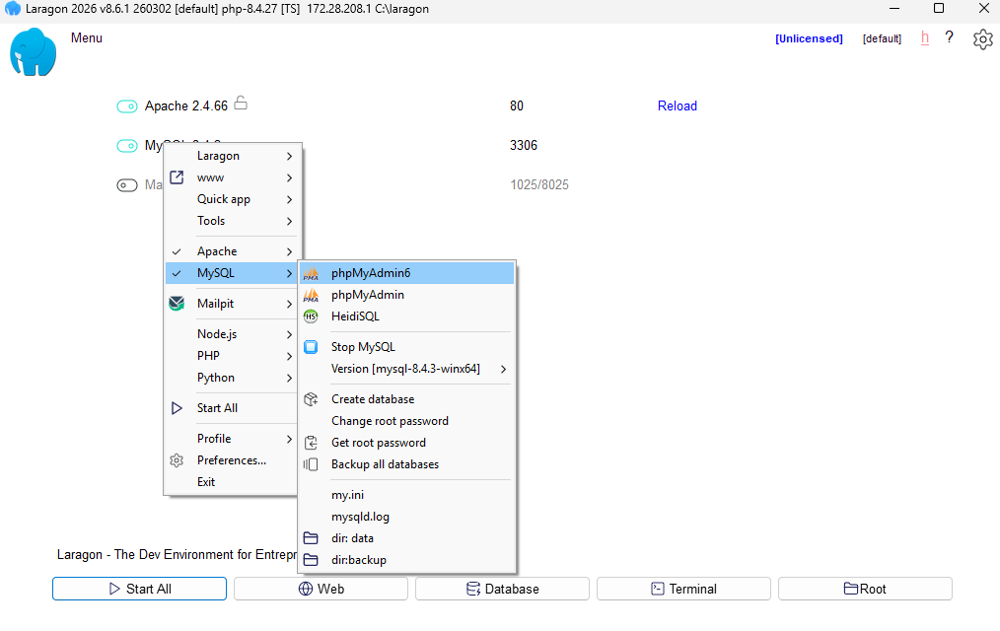
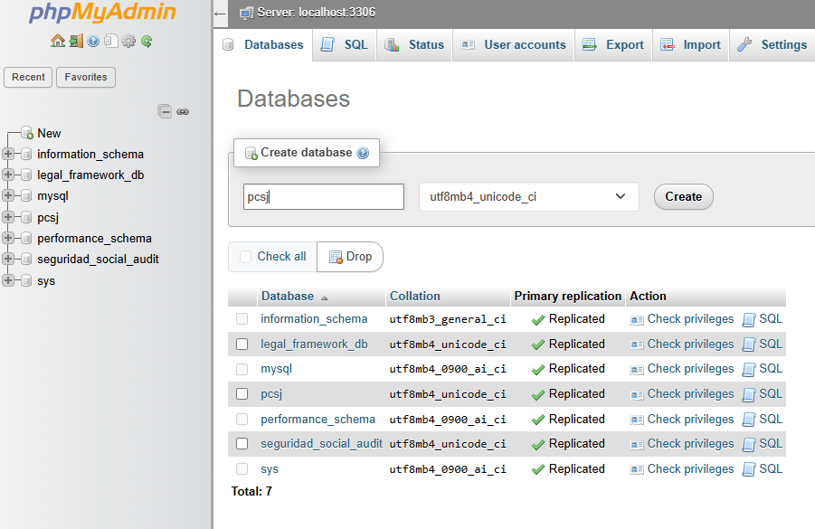

# Guía de instalación

1- Descargar Laragon Full desde https://laragon.org/download/

2- Ya Laragon trae PHP, Mysql y Composer.

3- Con los siguientes comandos puedes verficar que todo se instaló bien:
```php -v```
```composer -V```
```git --version```
```mysql --version```

Yo uso la version 8.4.27 de PHP pero de la 8.2 para arriba está bien y sirve para Laravel.

4- Clonar el repositorio en Github: https://github.com/nelsonacb/pcsj_bff

5- Instalar dependencias de PHP:
En la raíz del proyecto ejecutar el comando:
```composer install```

6- En la raíz del proyecto crear un .env con el mismo contenido del .env.example

7- Generar la APP_KEY:
Ejecutar el comando: ```php artisan key:generate```

8- Crear la base de datos en phpMyAdmin.
```html
 

Abrir http://localhost/phpmyadmin

El user por defecto es root y no hay que poner password.

```html
 

Pestaña "Bases de datos"

Nombre: pcsj

Cotejamiento: utf8mb4_unicode_ci

Crear.

O debe servir igual con el comando:
```mysql -u root -e "CREATE DATABASE pcsj CHARACTER SET utf8mb4 COLLATE utf8mb4_unicode_ci;"```

9- Ejecutar migraciones
En la raíz del proyecto ejecutar:
```php artisan migrate```

Verificar que se crearon las tablas:
```php artisan db:show```

10- Crear datos de prueba:
Correr el comando:
```php artisan db:seed --class=DemoSeeder```

11- Arrancar el servidor:
```php artisan serve```